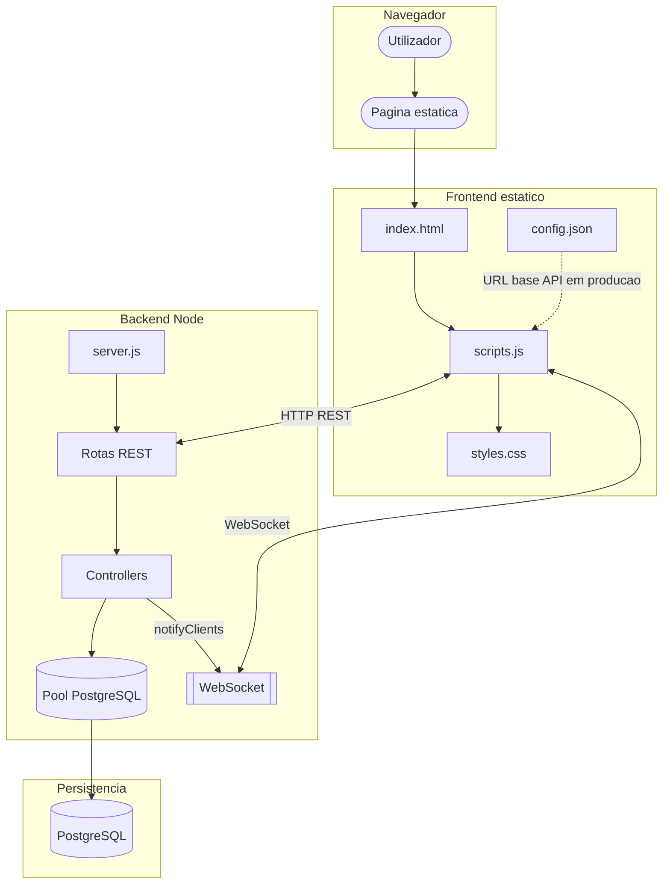
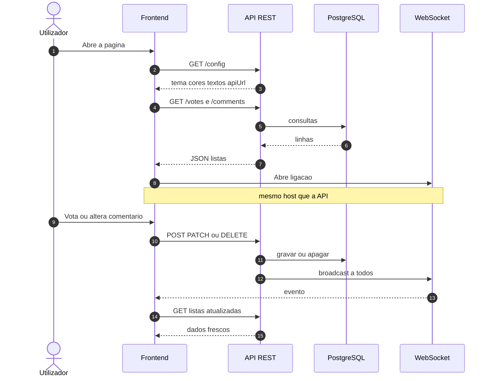

# 🎉👶 Votebaby — Chá revelação

Aplicação web para **chá revelação**: convidados votam **Menino** ou **Menina**, deixam comentários e veem o resultado atualizar em tempo real. O painel é configurável (cores, nomes dos bebês, texto da revelação, modo “ainda não revelou” ou já revelado), com animações, barras de percentagem e contadores.

O **frontend** é estático (HTML, CSS, JavaScript). O **backend** é Node.js com Express, PostgreSQL e WebSockets no mesmo processo HTTP.

---

## ✨ Funcionalidades

- 🗳️ **Votação** com percentagens e histórico; cada pessoa pode **alterar** o voto (modal) ou **apagar** (menu de contexto) apenas o próprio registo.
- 💬 **Comentários** com data/hora; o autor pode **editar** ou **apagar** só os próprios.
- ⚡ **Tempo real** para votos e comentários: o servidor notifica os clientes ligados por WebSocket após alterações.
- 🎀 **Modo revelação**: com resultado `pending` mostra votação e formulário de comentários; após revelar (`boy` / `girl`), ajusta layout, animações (🎈 balões, 🎊 confetes) e textos vindos da configuração.
- 🔑 **Identificação no navegador**: `browserId` em `localStorage` para permitir editar/apagar só o que é teu, sem contas.
- 🛡️ **CORS** limitado à origem configurada; **rate limiting** nas rotas de escrita de votos e comentários.

---

## 🛠️ Tecnologias

| Camada | Tecnologias |
|--------|-------------|
| Frontend | HTML5, CSS3, JavaScript (sem bundler) |
| Backend | Node.js, Express, `pg`, `ws`, `cors`, `dotenv`, `express-rate-limit`, `uuid`, `useragent` |
| Dados | PostgreSQL (ex.: Neon) |

---

## 🏗️ Arquitetura e fluxo

### 🗺️ Mapa de componentes



### ⏱️ Sequência: arranque e tempo real



### 📋 Resumo do cliente

1. Carrega a página e, conforme o ambiente, resolve o URL do backend (localhost em desenvolvimento; em produção lê `config.json` para o URL base).
2. Chama `GET /config` para textos, cores e `apiUrl` (definida pelo servidor com base no pedido).
3. Usa `apiUrl` para votos e comentários; mantém WebSocket no mesmo host para, ao receber eventos, voltar a pedir as listas.

---

## 📂 Estrutura do repositório

```text
.
├── frontend/
│   ├── config.json             # Em producao: URL HTTPS do backend (configBase)
│   ├── index.html
│   ├── css/
│   │   └── styles.css
│   └── js/
│       └── scripts.js          # UI, API, WebSocket, modais, menu de contexto
├── backend/
│   ├── server.js               # Express, CORS, rate limit, trust proxy
│   ├── db.js                   # Pool PostgreSQL
│   ├── websocket.js            # Servidor WS e notificacoes apos votos e comentarios
│   ├── package.json
│   ├── nodemon.json            # Watch para npm run dev
│   ├── .env.example
│   ├── database/
│   │   └── schema.sql          # Tabelas votes e comments
│   ├── routes/
│   │   ├── index.js            # Monta /votes, /comments, /config
│   │   ├── votes.js
│   │   ├── comments.js
│   │   └── config.js           # JSON de configuracao do painel
│   ├── controllers/
│   │   ├── votes.js
│   │   └── comments.js
│   └── utils/
│       └── helpers.js
└── README.md
```

---

## 📦 Pré-requisitos

- [Node.js](https://nodejs.org/) (recomendado: LTS)
- [npm](https://www.npmjs.com/)
- Base **PostgreSQL** acessível (ex.: [Neon](https://neon.tech))
- [Git](https://git-scm.com/) (opcional)

---

## ⚙️ Backend

### Clonar e instalar

```bash
git clone https://github.com/ramirodavi/votebaby.git
cd votebaby/backend
npm install
```

### Base de dados

Cria a base e executa [`backend/database/schema.sql`](backend/database/schema.sql) no teu cliente SQL.

### Variáveis de ambiente

```bash
cp .env.example .env
```

Edita o `.env`: credenciais PostgreSQL, `FRONTEND_URL` (origem permitida pelo CORS), `NODE_ENV`, textos e cores do chá, etc. O [`.env.example`](backend/.env.example) documenta cada variável. **Não commites o `.env`**.

### Arranque

| Comando | Uso |
|---------|-----|
| `npm start` | Executa `node server.js`. Usa em produção (Render, etc.). |
| `npm run dev` | Desenvolvimento com **nodemon** (reinício ao alterares código em `routes`, `controllers`, `server.js`, `db.js` ou `.env`). |

Equivalente manual:

```bash
npx nodemon server.js
```

---

## 🖥️ Frontend

Não há `npm` no frontend: abre a pasta com um servidor HTTP local (ex.: **Live Server** em `http://127.0.0.1:5500`).

### Desenvolvimento local

Com o hostname **localhost** ou **127.0.0.1**, o `scripts.js` usa o backend em `http://localhost:3000` para `GET /config` e para a API.

### Produção (ex.: GitHub Pages)

O ficheiro [`frontend/config.json`](frontend/config.json) define o URL **HTTPS** da API (sem barra no fim), para o primeiro pedido à configuração:

```json
{
  "configBase": "https://teu-backend.onrender.com"
}
```

Confirma que **`FRONTEND_URL`** no `.env` do backend coincide com o URL público do site (CORS).

---

## 🔌 API (resumo)

| Método | Caminho | Descrição |
|--------|---------|-----------|
| `GET` | `/config` | Configuração do painel (textos, cores, `apiUrl`, etc.) |
| `GET` | `/votes` | Lista de votos |
| `POST` | `/votes` | Corpo: `name`, `gender`, `browserId` — cria ou atualiza |
| `DELETE` | `/votes/:id?browserId=` | Remove voto próprio |
| `GET` | `/comments` | Lista de comentários |
| `POST` | `/comments` | Novo comentário |
| `PATCH` | `/comments/:id?browserId=` | Atualiza comentário próprio |
| `DELETE` | `/comments/:id?browserId=` | Remove comentário próprio |

**WebSocket:** mesmo host/porta que a API; após alterações em votos ou comentários o cliente atualiza a lista correspondente.

---

## 🌐 Deploy

### ☁️ API (ex.: Render)

1. Criar **Web Service** com o código do `backend`.
2. Variáveis de ambiente: PostgreSQL, `NODE_ENV=production`, `FRONTEND_URL` com o URL do site estático, etc.
3. **Build:** `npm install`
4. **Start:** `npm start`  
5. O serviço injeta `PORT`; o host público do pedido define o `apiUrl` devolvido em `/config`.

### 📄 Site estático (ex.: GitHub Pages)

1. Publicar a pasta `frontend`.
2. Ajustar `config.json` com o URL HTTPS do backend.
3. Garantir que `FRONTEND_URL` no backend corresponde ao URL do GitHub Pages.

---

## 📜 Licença

Projeto de código aberto para fins educacionais, eventos ou uso pessoal. Contribuições são bem-vindas.

---

## 📧 Contato

- **Email:** davilopesramiro@gmail.com  
- **GitHub:** [ramirodavi](https://github.com/ramirodavi/)
